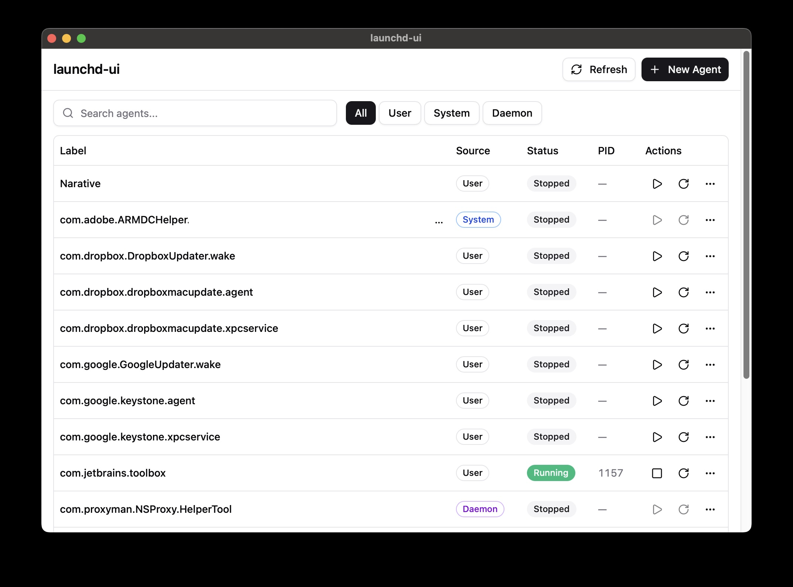

# launchd-ui

A GUI application for managing macOS launchd agents and daemons. Built with Tauri v2.

Browse user LaunchAgents (`~/Library/LaunchAgents/`) and system agents/daemons. Start, stop, restart, view/edit plist files, and create new agents.



## Features

- List User Agents (`~/Library/LaunchAgents/`), System Agents, and System Daemons
- Search by label and filter by source (User / System / Daemon)
- Start / Stop / Restart / Test Run (immediate execution) for User Agents
- Create new agents, edit and delete existing ones
- Schedule configuration (interval / calendar) with next run time preview
- View stdout / stderr logs
- Inspect plist configuration details
- Reveal plist file in Finder

System Agents and Daemons are read-only. Modification operations are limited to User Agents.

## Install

This app is not code-signed. Download and install via CLI:

```bash
# Download and extract (Apple Silicon)
curl -fL "https://github.com/azu/launchd-ui/releases/latest/download/launchd-ui_aarch64.app.tar.gz" | tar xz -C /Applications
# Remove quarantine attribute (required for unsigned apps)
xattr -cr /Applications/launchd-ui.app
```

For Intel Macs, download the `x64` archive instead:

```bash
curl -fL "https://github.com/azu/launchd-ui/releases/latest/download/launchd-ui_x64.app.tar.gz" | tar xz -C /Applications
xattr -cr /Applications/launchd-ui.app
```

DMG installers are also available on the [Releases](https://github.com/azu/launchd-ui/releases) page.

## Tech Stack

- Tauri v2 (Rust backend) + React + TypeScript + Vite
- UI: Tailwind CSS v4 + shadcn/ui
- Lint: oxlint (TypeScript), cargo clippy + rustfmt (Rust)
- Test: vitest (Frontend), cargo test (Rust)
- Package manager: pnpm

## Development

```bash
# Install dependencies
pnpm install

# Dev mode (launches app with hot reload)
pnpm tauri:dev

# Frontend only
pnpm dev

# Production build (DMG)
pnpm tauri:build
```

## Testing / Lint

```bash
pnpm test          # vitest (frontend)
pnpm lint          # oxlint
pnpm typecheck     # TypeScript type check
pnpm test:release  # Release/version script tests (node:test)

cargo test --manifest-path src-tauri/Cargo.toml          # Rust tests
cargo fmt --manifest-path src-tauri/Cargo.toml --check   # Rust format check
cargo clippy --manifest-path src-tauri/Cargo.toml -- -D warnings  # Rust lint
```

## Release

Releases are made through a release PR:

1. Run the [Create Release PR](https://github.com/azu/launchd-ui/actions/workflows/create-release-pr.yml) workflow and choose `patch`, `minor`, or `major`.
   It bumps the version in `package.json`, `src-tauri/tauri.conf.json`, `src-tauri/Cargo.toml`, and `src-tauri/Cargo.lock`, and opens a PR labeled `Type: Release`. The PR body is used as the release notes, so edit it as needed.
2. Merge the PR. The Release workflow creates a draft release, builds the Apple Silicon (`aarch64`) and Intel (`x64`) apps, checks that all assets were uploaded, and then publishes the release and its `vX.Y.Z` tag.

The four version files must always match. `pnpm version:check` verifies this, and `pnpm version:patch` / `version:minor` / `version:major` bump them together locally. Do not edit them by hand or with `npm version`.

The Create Release PR workflow needs "Allow GitHub Actions to create and approve pull requests" enabled under Settings > Actions > General > Workflow permissions. Because the release PR is opened with `GITHUB_TOKEN`, its CI run waits for approval from someone with write access.

## License

MIT
